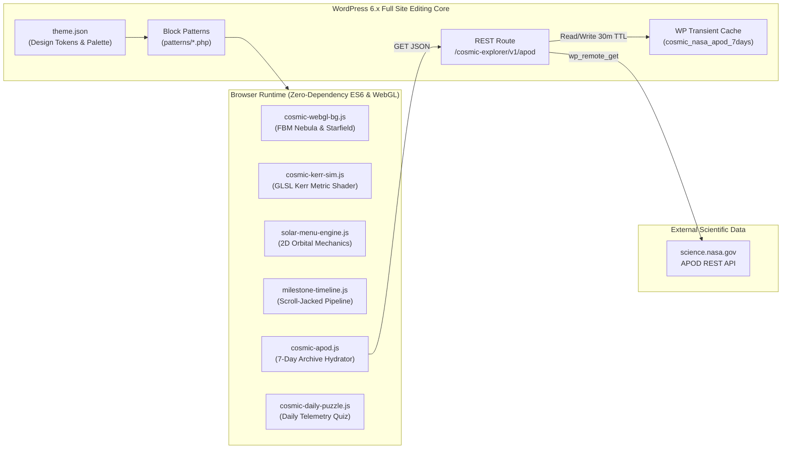

<div align="center">

# Cosmic Explorer

**Hardware-accelerated astrophysics simulation portal and WordPress Full Site Editing (FSE) block theme modeled on NASA JPL and TUBITAK UZAY telemetry interfaces.**

[](https://wordpress.org/)
[](https://www.php.net/)
[](https://www.khronos.org/webgl/)
[](https://api.nasa.gov/)
[](https://www.gnu.org/licenses/gpl-2.0.html)

[Overview](#overview) · [Core Capabilities](#core-capabilities) · [Architecture](#architecture) · [Simulations & Modules](#simulations--modules) · [Getting Started](#getting-started) · [Directory Structure](#directory-structure) · [Interaction Matrix](#interaction-matrix)

</div>

---

## Overview

### Problem Statement

Conventional educational astronomy websites rely on static imagery, third-party iframe embeds, and generic template layouts that disconnect theoretical astrophysics from interactive observation. Furthermore, direct client-side polling of external space agency endpoints often suffers from rate-limiting, uncached latency spikes, and layout shifts across mobile viewports.

### Solution

**Cosmic Explorer** is a custom WordPress Full Site Editing (FSE) block theme that integrates custom WebGL/GLSL fragment shaders, an interactive 2D Keplerian orbital mechanics canvas, and a transient-cached NASA APOD REST service directly into a zero-dependency front-end architecture. The visual design system enforces institutional typography, high-contrast obsidian surfaces, and technical telemetry readouts inspired by NASA Jet Propulsion Laboratory (JPL) and TUBITAK Space Technologies Research Institute (TUBITAK UZAY).

---

## Core Capabilities

* **Relativistic Kerr Black Hole Shader (`cosmic-kerr-sim.js`):** Real-time GLSL ray-plane intersection and gravitational lensing simulation featuring photon sphere caustics, event horizon shadow masking, and Keplerian accretion disk relativistic Doppler beaming ($a/M = 0.94$).
* **Volumetric Deep-Space Background (`cosmic-webgl-bg.js`):** Hardware-accelerated 60 FPS background canvas rendering 1,400+ spectral point stars with brightness scintillation and 4-octave Fractional Brownian Motion (FBM) nebula dust clouds. Automatically suspends execution via `document.hidden` to conserve GPU/CPU power.
* **Interactive Solar System Orbital Portal (`solar-menu-engine.js`):** Fullscreen interactive navigation simulator modeling heliocentric planetary orbits, spacecraft trajectories (ISS, JWST, Voyager 1, IMECE), live Keplerian velocity readouts, and category filtering.
* **Inertia-Safe Mission Timeline (`milestone-timeline.js`):** Horizontal mission pipeline documenting key milestones from Vostok 1 (1961) and Apollo 11 (1969) to TUBITAK UZAY IMECE (2023) and Artemis II–IV, featuring MacBook trackpad momentum debouncing and directional slide transitions.
* **Transient-Cached NASA APOD Service (`functions.php` & `cosmic-apod.js`):** Server-side WordPress REST endpoint (`/wp-json/cosmic-explorer/v1/apod`) fetching the latest 7 days of verified NASA Astronomy Picture of the Day records, cached via WordPress transients (`1800s` TTL) with deterministic local fallback.
* **Mobile Touch & Gesture Ergonomics:** Mathematical two-finger pinch-to-zoom ($d = \sqrt{\Delta x^2 + \Delta y^2}$), double-tap camera reset with tactile haptic feedback (`navigator.vibrate`), `touchcancel` state recovery, and WCAG 2.1 AA compliant $\ge 44 \times 44\text{px}$ hit targets.

---

## Architecture



---

## Simulations & Modules

| Module | Engine / Technology | Primary Mathematical / Technical Model | Target Surface |
| :--- | :--- | :--- | :--- |
| **Kerr Black Hole Lab** | WebGL / GLSL Fragment Shader | Gravitational deflection $\Delta \theta \propto r^{-2}$, Doppler factor $D = 1 + v_{\text{orb}}\sin(\phi - \psi)$ | `patterns/black-holes.php` |
| **Deep Space Starfield** | WebGL Dual-Program Pipeline | 4-octave FBM noise + 3D parallax projection | `parts/header.html` (`#cosmicWebglBg`) |
| **Solar System Portal** | HTML5 2D Canvas | Parametric orbital ellipses, smooth camera pan & zoom interpolation | `parts/header.html` (`#solarMenuOverlay`) |
| **Mission Chronology** | Vanilla JS State Machine | Debounced wheel delta threshold + touch vector classification | `patterns/mission-timeline.php` |
| **NASA APOD Bulletin** | WP REST API + Transients | Server-side sanitization, date localization, resilient fallback array | `patterns/nasa-apod.php` |
| **Daily Telemetry Quiz** | LocalStorage State Engine | Deterministic daily seed, progressive clue reveal, streak persistence | `patterns/space-quiz.php` |

---

## Getting Started

### Prerequisites

* **PHP:** `8.1` or higher
* **WordPress:** `6.4` or higher (Full Site Editing support required)
* **Web Server:** Apache (XAMPP / WAMP) or Nginx with `mod_rewrite` enabled

### Installation

1. Clone this repository into your WordPress installation root (or copy `wp-content/themes/cosmic-explorer` directly into your existing `wp-content/themes/` directory):

```bash
git clone https://github.com/Hanubaki/CosmicExplorer.git
```

2. Configure your local `wp-config.php` using `wp-config-sample.php` and connect to your MySQL/MariaDB instance.

3. Activate the **Cosmic Explorer** theme via **WP Admin -> Appearance -> Themes** or using WP-CLI:

```bash
wp theme activate cosmic-explorer
```

---

## Testing & Verification

Validate PHP template syntax and JavaScript compilation integrity prior to deployment:

```powershell
# Verify PHP syntax across all theme files
php -l wp-content/themes/cosmic-explorer/functions.php
Get-ChildItem wp-content/themes/cosmic-explorer/patterns/*.php | ForEach-Object { php -l $_.FullName }

# Verify JavaScript syntax across all simulation engines
Get-ChildItem wp-content/themes/cosmic-explorer/assets/js/*.js | ForEach-Object { node -c $_.FullName }
```

---

## Directory Structure

```text
.
├── .agent/                                     # Agent engineering skills and architectural rules
│   ├── rules/                                  # Global and workspace verification protocols
│   └── skills/                                 # 28 specialized engineering runbooks
├── wp-content/
│   └── themes/
│       └── cosmic-explorer/                    # Custom WordPress FSE Block Theme
│           ├── assets/
│           │   ├── css/
│           │   │   └── cosmic-effects.css      # Institutional UI tokens, glass surfaces, responsive rules
│           │   ├── images/                     # Curated NASA/ESA/JWST high-resolution observational assets
│           │   └── js/
│           │       ├── cosmic-apod.js          # Client-side NASA APOD 7-day archive controller
│           │       ├── cosmic-daily-puzzle.js  # Daily astrophysics telemetry quiz engine
│           │       ├── cosmic-interactivity.js # WordPress Interactivity API store definitions
│           │       ├── cosmic-kerr-sim.js      # Real-time WebGL Kerr Black Hole raymarching simulator
│           │       ├── cosmic-sidebar.js       # Contextual table-of-contents and reading tracker
│           │       ├── cosmic-webgl-bg.js      # Fullscreen WebGL volumetric nebula and starfield
│           │       ├── milestone-timeline.js   # Inertia-safe horizontal mission chronology engine
│           │       └── solar-menu-engine.js    # Interactive 2D Keplerian solar system navigator
│           ├── parts/
│           │   ├── header.html                 # Top navigation bar & Solar System portal overlay
│           │   └── footer.html                 # Institutional directory (TUBITAK UZAY, TUG, NASA, ESA)
│           ├── patterns/                       # Modular PHP block patterns (Hero, Black Holes, Timeline, etc.)
│           ├── styles/                         # Theme style variations (Deep Space, Nebula Glow, Retro Sci-Fi)
│           ├── templates/                      # FSE HTML page templates (front-page, archive, single, 404)
│           ├── functions.php                   # Script enqueuing, caching, and NASA APOD REST API route
│           ├── style.css                       # Theme metadata header
│           └── theme.json                      # Global FSE typography, color palette, and layout settings
├── .gitignore                                  # Excludes WP core, wp-config.php secrets, and runtime logs
└── README.md                                   # Repository technical documentation
```

---

## Interaction Matrix

| Context | Input / Gesture | Action |
| :--- | :--- | :--- |
| **Kerr Black Hole Simulator** | `Mouse Drag` / `1-Finger Touch Move` | Orbit camera $360^\circ$ (yaw) and adjust inclination pitch ($5^\circ$–$80^\circ$) |
| **Kerr Black Hole Simulator** | `Mouse Wheel` / `2-Finger Pinch` | Zoom camera radial distance ($2.0r_s$ to $7.8r_s$) |
| **Kerr Black Hole Simulator** | `Double Click` / `Double Tap` | Reset camera orientation to default telemetry state + haptic pulse |
| **Solar System Portal** | `Mouse Drag` / `2-Finger Pinch` | Pan orbital plane and scale zoom factor around midpoint |
| **Solar System Portal** | `ESC` | Close fullscreen orbital overlay |
| **Mission Timeline** | `Mouse Wheel` / `Arrow Keys` / `Swipe` | Advance or rewind chronological space mission slides |

---

## Author & License

* **Maintainer:** Berke Akdemir ([@Hanubaki](https://github.com/Hanubaki))
* **License:** Distributed under the GNU General Public License v2.0 or later (`GPL-2.0-or-later`). Astronomical imagery and observational telemetry courtesy of NASA, ESA, CSA, STScI, EHT Collaboration, and TUBITAK UZAY public archives.
